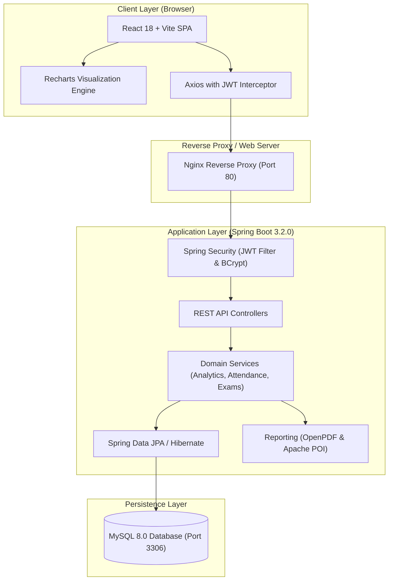
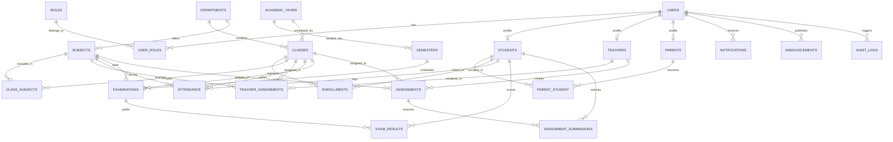
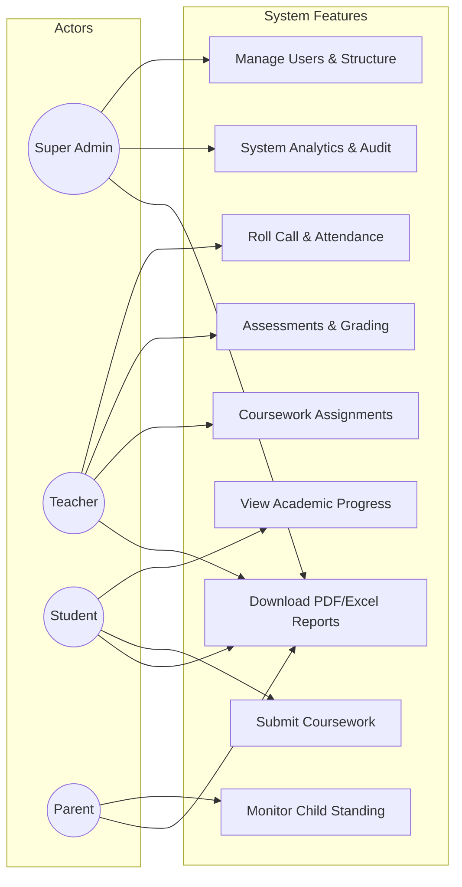
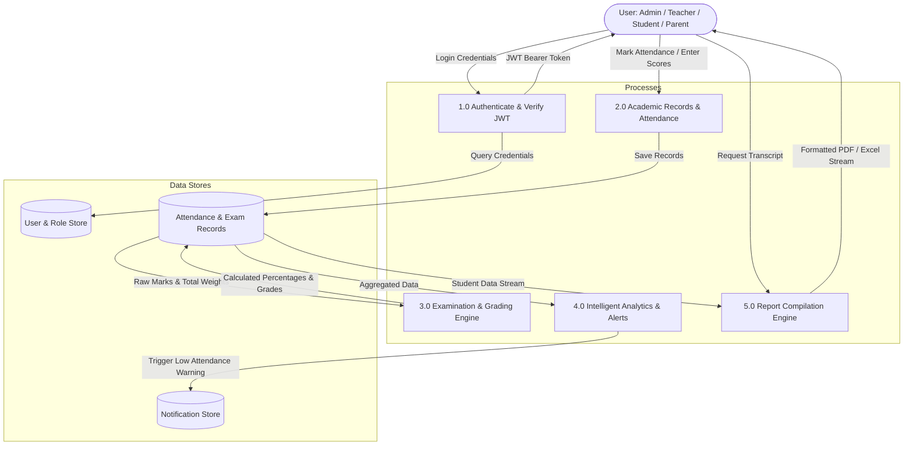

# System Architecture & Technical Specifications

## 1. System Architecture Diagram

---

## 2. Entity-Relationship (ER) Diagram

---

## 3. Use Case Diagram

---

## 4. Data Flow Diagram (DFD Level 1)

